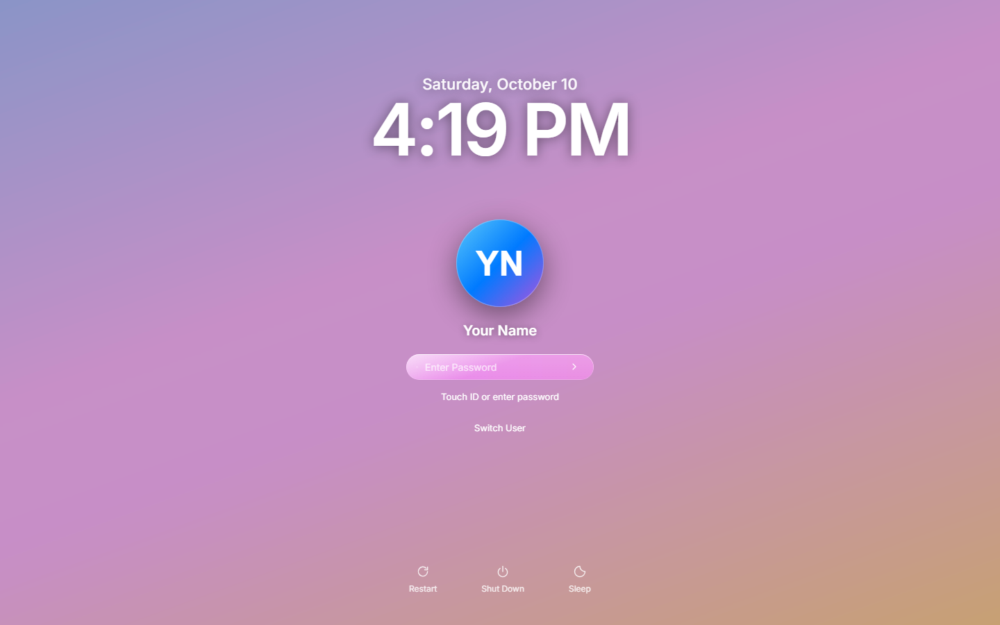
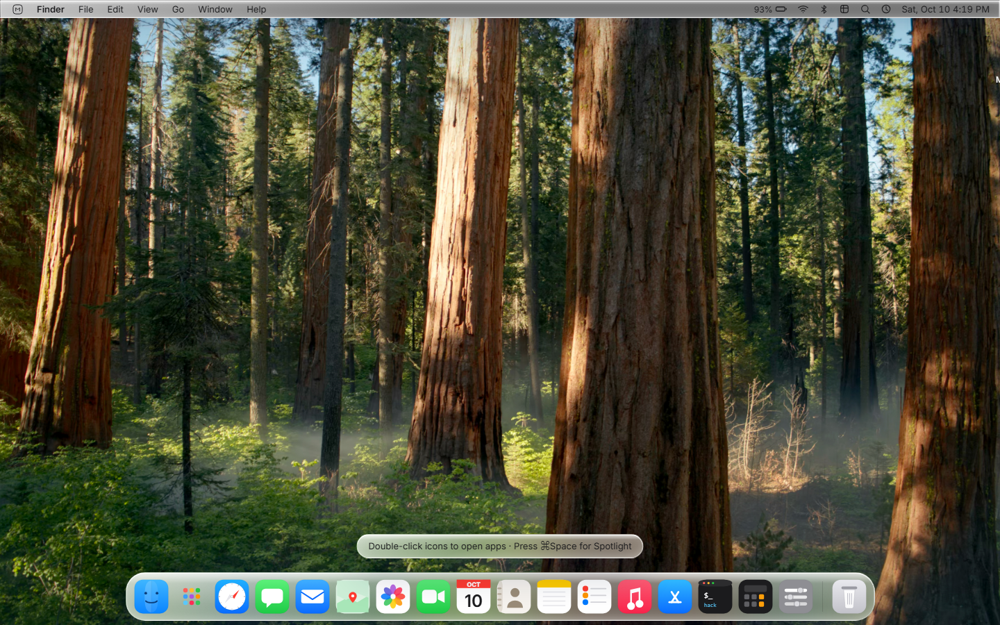
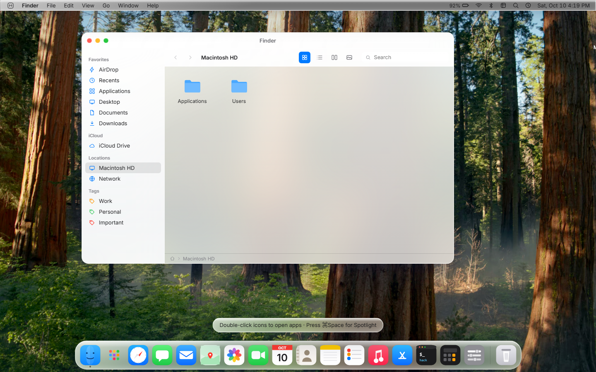

# macOS Portfolio — Liquid Glass Edition

> A fully interactive, pixel-faithful macOS desktop — rebuilt in React and styled as **macOS Tahoe "Liquid Glass"**. Boot it, log in, drag windows, hit Spotlight, and browse the dock. It doubles as a personal developer portfolio.





---

## Features

### System UI
- **Boot → Lock → Desktop → Sleep / Shut Down / Restart** lifecycle with animated transitions and sound effects.
- **Liquid Glass design system** — multi-layer translucent materials, specular sheens, optical lensing, animated dock reflection sweep, theme-aware in dark & light.
- **Dynamic Desktop & lock screen** built on your wallpapers (gradients or images).
- **Fully draggable, resizable, minimizable windows** with geometry transitions, "genie" minimize, zoom, and per-window opacity/focus behavior.
- **Mission Control**, **Launchpad**, **app switcher (⌘Tab)**, **Spotlight (⌘Space)**.
- **Control Center & Notification Center** with live clock, dark-mode toggle, WiFi/Bluetooth/AirDrop/volume/brightness controls, and a working **Night Shift-style wallpaper tinting** toggle.
- **Native-feeling interactions**: right-click context menus, click-through panel dismissal, cursor affordances, correct traffic-light hit areas, and haptic-grade micro-interactions.

### Apps
| App | What it does |
| --- | --- |
| Finder | Browse the virtual file system (`src/data/fs.js`), open apps, preview files |
| Safari | Browse real websites in a glass window |
| Notes | Markdown-ish notes backed by the profile |
| Photos | Personal gallery |
| Messages / Mail / FaceTime / Contacts | Social & contact surfaces fed by `profile.js` |
| Music | Real audio playback with a mini player |
| Calendar / Clock / Weather / Reminders / Maps | Live utilities (Maps = real OpenStreetMap embed) |
| Calculator | Correct classic logic: chained ops, repeat `=`, `%`, float-safe formatting, keyboard input |
| Terminal | Real shell-ish commands: `ls`, `cat`, `open`, `neofetch`, `help`, … |
| Settings | Appearance, wallpapers, displays, dock, sound, privacy — all live |
| App Store / Preview / About This Mac / Trash | Fill out the world |

### Shortcuts
| Keys | Action |
| --- | --- |
| `⌘Space` | Spotlight |
| `⌘Tab` / `⌘⇧Tab` | App switcher |
| `⌘Q` / `⌘W` / `⌘M` | Quit / close / minimize active window |
| `⌘,` | Open System Settings |
| `⌘⇧3` | Capture a screenshot of the desktop |
| `⌘⇧L` | Lock the Mac |
| `F1`/`F3`/`Ctrl–M` | Launchpad |
| `Esc` | Close panels / dialogs |

### Demo helpers
Append query params for instant demo states:
- `?skp=1` — skip boot and go straight to the desktop
- `?wall=sequoia` — force a specific wallpaper (`sonoma`, `ventura`, `graphite`, `sunrise`, `aqua`, `bigsur`, `monterey`, `sequoia`, `custom`)
- `?app=finder` — open an app on load

---

## Getting started

```bash
npm install     # install dependencies
npm run dev     # start the dev server
```

Build & preview:

```bash
npm run build   # production build → dist/
npm run preview # preview the build locally
npm run lint    # oxlint
```

**Requirements:** Node.js 20+ (uses Vite 8 and React 19).

---

## Making it yours

Everything personal lives in **one file** — `src/data/profile.js`:

- Name, location, tagline, avatar (SVG data-URI), role
- Work experience, education, skills, projects
- System details shown in *About This Mac* (macOS Tahoe 26)

The Finder file system, Notes, Terminal, Music, Photos, Mail and Contacts all read from this single source of truth.

**Wallpapers:** drop images into `public/wallpapers/` and register them in `defaultWallpapers()` in `src/system/store.js`.

**Adding an app:**
1. Create a component in `src/apps/`
2. Add its metadata to `src/data/appsMeta.js` (name, default size, dock order)
3. Register the component in `src/system/registry.jsx`

---

## Project structure

```
src/
├── apps/            # Individual apps (Finder, Safari, Music, …)
├── data/            # profile.js, appsMeta.js, fs.js (virtual filesystem)
├── icons/           # App icons + UI icon set
├── styles/          # global / desktop / window / apps + tahoe.css (Liquid Glass)
└── system/          # OS core: store, Window, Dock, MenuBar, Launchpad, …
```

## Tech stack

- **React 19** + **Vite 8**
- **oxlint** for linting
- Plain CSS (no UI framework) — custom design system with CSS variables, `backdrop-filter` glass materials, and `prefers-reduced-motion` / `prefers-reduced-transparency` fallbacks
- **OpenStreetMap** embed for the Maps app
- Hosted static build (`dist/`)

## Deploy

The build output is fully static:

```bash
npm run build
```

Serve `dist/` anywhere — Vercel, Netlify, GitHub Pages, or a simple static host.

---

*Not affiliated with Apple. Built as a design & engineering showcase.*